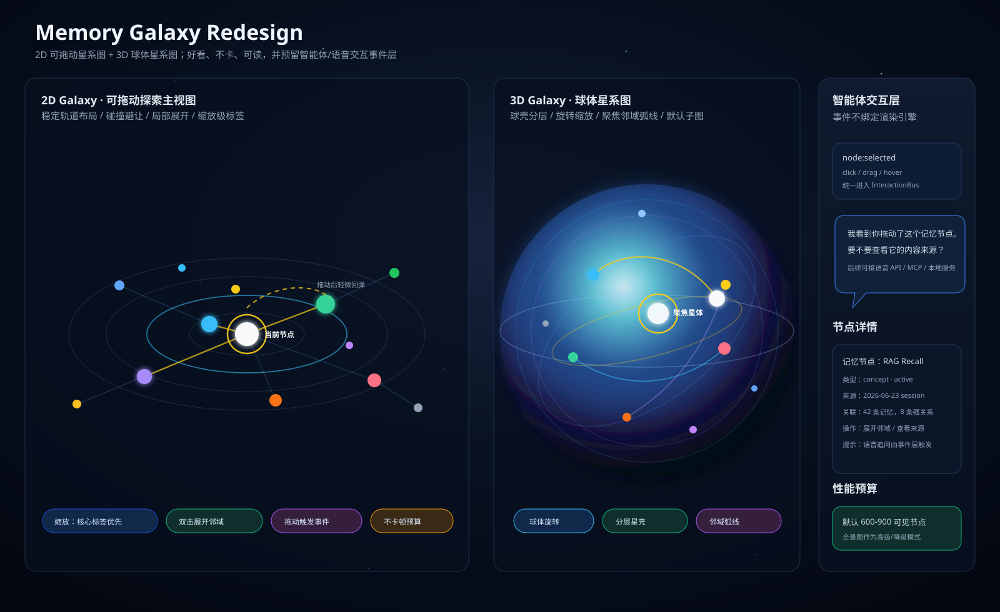

# Memory Galaxy Redesign Design Spec

## Summary

Total Agent Memory's current graph visualization should become a galaxy-first memory exploration system. The traditional flat 2D graph view will be replaced by a playable 2D galaxy map, and the 3D view will become a spherical galaxy made of layered memory shells. Both views must stay beautiful, draggable, readable, and responsive on the current local static viewer model.

This design intentionally keeps rendering, graph layout, and intelligent-agent reactions separated. A click, drag, hover, focus, or neighborhood expansion should emit a normalized interaction event, so later work can connect voice APIs, local agents, MCP actions, or provenance prompts without rewriting the visualization engine.

Preview reference:



## Goals

- Replace the existing 2D analysis-style graph with a 2D galaxy map.
- Redesign the 3D view as a spherical memory galaxy, not a generic force-directed hairball.
- Make nodes draggable and pleasant to manipulate, with enough physical response to feel playful.
- Reduce visual overlap through deterministic galaxy placement, collision spacing, label gating, and focus subgraphs.
- Make information easier to understand through semantic layers, selected-node context, source/provenance details, and relationship paths.
- Preserve performance by rendering a curated visible graph by default, not the full memory database.
- Provide a stable event bridge for future intelligent-agent and voice interactions.
- Keep live memory data local. The static viewer must not upload memory content by default.

## Non-Goals

- Do not build a hosted web service in this phase.
- Do not add live writes to the SQLite memory database from the browser.
- Do not require the user to upload private memory graph data to external services.
- Do not keep the old 2D Cytoscape-style graph as the primary 2D experience.
- Do not render every exported node with labels at once.
- Do not connect a real voice API in this phase; only design and implement the event boundary needed for it.

## Current Context

The real visualization system lives in `C:\Users\Administrator\total-agent-memory`.

Relevant files:

- `src/tools/memory_graph_viewer_export.py` exports `graph.json`.
- `src/tools/memory_graph_viewer_assets/index.html` is the current 2D entry.
- `src/tools/memory_graph_viewer_assets/viewer.js` powers the current 2D graph.
- `src/tools/memory_graph_viewer_assets/viewer-3d.html` is the current galaxy entry.
- `src/tools/memory_graph_viewer_assets/viewer-3d.js` powers the current galaxy view.
- `src/tools/memory_graph_viewer_assets/memory-galaxy-core.js` contains testable graph conversion, filtering, focus, and expansion helpers.
- `src/tools/memory_graph_viewer_assets/styles.css` contains shared viewer styling.
- `tests/test_memory_graph_viewer_export.py` covers export behavior.
- `tests/js/memory_galaxy_smoke.test.mjs` covers pure JavaScript galaxy helpers.

There is existing uncommitted work in `src/tools/memory_graph_viewer_assets/viewer-3d.js` that adds `expansionViewNodeId` and a focused node-expansion view. Implementation must inspect and preserve this work unless the user explicitly asks to discard it.

## Product Experience

### 2D Galaxy View

The 2D view becomes the default practical exploration surface. It should feel like dragging and zooming through a memory star map, not like manipulating a spreadsheet or generic network diagram.

Expected behavior:

- Pan and zoom the galaxy canvas.
- Drag individual memory nodes.
- Dragged nodes should feel responsive, then settle without exploding the layout.
- Click selects a node and opens a readable detail panel.
- Double-click or command button expands a selected node's neighborhood.
- Right-click or a clear control exits neighborhood focus.
- Search filters the visible galaxy while preserving spatial stability.
- Timeline and type/layer filters narrow the galaxy.
- Labels appear by importance and zoom level to avoid text collisions.
- Only selected, hovered, core, and high-importance nodes show labels at low zoom.
- Relation lines are subtle by default and stronger for selected-node paths.

Visual model:

- Nodes are stars.
- Node size reflects importance, activity, and freshness.
- Color reflects semantic type or layer.
- Galaxy rings or spiral bands represent memory layers: core, active, knowledge, episode, external.
- Selected node gets a visible halo.
- Expanded-neighborhood links get a stronger highlight.
- Motion and glow must be restrained enough that information remains readable.

### 3D Spherical Galaxy View

The 3D view becomes a spherical memory galaxy. It is for spatial exploration, delight, and high-level understanding.

Expected behavior:

- Rotate, zoom, and inspect a layered sphere of memory nodes.
- Nodes sit on semantic shells around a center, not in an uncontrolled force blob.
- Click selects a star and shows details.
- Focus mode brings a node and its high-value neighbors forward.
- Relationship arcs show meaningful nearby paths.
- Default rendering uses a curated focus graph, not all exported nodes.
- Full graph mode exists only as an advanced action and may warn about performance.

Visual model:

- Core memories appear near the center or inner shell.
- Active and recent memories appear on bright middle shells.
- General knowledge, episodes, and external entities occupy outer shells.
- Selected node gets a halo and relationship arcs.
- Distant nodes fade rather than competing equally.

## Information Design

The viewer should make memory information easier to understand without requiring the user to read every node.

The selected-node detail panel should include:

- Label and type.
- Galaxy layer.
- Importance, activity, freshness, and mention count.
- Last seen time and source.
- Project, if available.
- Linked memory summaries.
- Direct neighbors grouped by relation type.
- A provenance/source section that can later power agent questions such as: "Do you want to know where this node came from?"

The visual encoding should prioritize:

- Core rules and decisions.
- Active/recent project knowledge.
- Strong relation paths.
- The selected node's local neighborhood.
- Search matches.

## Performance Requirements

Performance is a hard requirement, not polish.

Default budgets:

- 2D default visible nodes: 600-900.
- 3D default visible nodes: 350-700.
- Full graph rendering is opt-in and may be slower.
- Labels are gated by zoom, selection, hover, and importance.
- Particle or animated link effects only run for selected or focused relationships.
- Layout should be deterministic enough that filtering does not reshuffle the whole map unnecessarily.
- Heavy computations should live in pure helper modules where they can be tested and later moved to a worker if needed.

The first usable implementation should pass these practical checks:

- The page loads the exported graph without freezing.
- Default view becomes interactive within a few seconds on the current machine.
- Dragging a node does not cause uncontrolled graph collapse.
- Search and filter changes debounce and complete without visible lockups.
- The selected node and its links remain visually clear.

## Interaction Event Layer

Future agent and voice behavior must be designed into the architecture now.

Rendering code must emit normalized interaction events through a small event bridge instead of directly calling future agent APIs.

Example events:

```json
{
  "type": "node:selected",
  "node_id": "concept:memory-rag",
  "gesture": "click",
  "view": "2d-galaxy",
  "timestamp": "2026-06-24T00:00:00.000Z",
  "context": {
    "visible_neighbors": 18,
    "layer": "active",
    "selected_mode": "focus"
  }
}
```

Required event types for the redesign:

- `node:selected`
- `node:hovered`
- `node:drag-started`
- `node:dragged`
- `node:drag-ended`
- `node:expanded`
- `view:filtered`
- `view:focus-cleared`
- `agent:suggestion-staged`

Initial event handling:

- Store recent events in local browser state for debugging.
- Show a small non-invasive prompt in the detail panel when useful.
- Do not call external services.
- Do not upload node content.

Future adapters should be able to consume the same events for:

- Voice prompts.
- Source/provenance explanation.
- Agent-guided memory cleanup.
- Relation suggestions.
- Skill/rule extraction suggestions.
- Local MCP or WebSocket actions.

## Architecture

The redesign should split responsibilities into clear modules.

### Export Layer

`memory_graph_viewer_export.py` continues to export a static `graph.json`. It may add fields needed by the galaxy views, such as:

- stable layout seed,
- semantic layer,
- freshness,
- activity,
- provenance/source fields,
- relation summaries,
- neighborhood score,
- path or cluster hints.

The exporter remains read-only against SQLite and writes only viewer output files.

### Graph Model Layer

`memory-galaxy-core.js` remains or evolves into the testable core. It should own:

- converting exported graph data into a normalized galaxy graph,
- filtering,
- scoring nodes,
- choosing focus subgraphs,
- computing deterministic 2D positions,
- computing deterministic 3D sphere positions,
- grouping neighbors and relation paths.

This layer must not depend on DOM APIs.

### Rendering Layer

2D and 3D rendering should be separate adapters over the same graph model.

2D renderer:

- Draws the 2D galaxy.
- Handles pan, zoom, node drag, hover, and selection.
- Uses deterministic positions plus local drag offsets.

3D renderer:

- Draws the spherical galaxy.
- Handles orbit/rotation, zoom, hover, and selection.
- Uses sphere shell positions from the graph model.

The implementation plan may choose the final rendering libraries, but the design preference is:

- 2D: PixiJS if the priority is playful canvas interaction, or Sigma custom rendering if graph operations dominate.
- 3D: Three.js if spherical layout control matters most, or `3d-force-graph` only if it can be constrained to fixed shell positions.

Given the user's requirement for playfulness and a sphere-based 3D galaxy, this spec prefers PixiJS for 2D and Three.js for 3D unless implementation research finds a strong blocker.

### Interaction Bridge

Create a small viewer-local interaction bridge that accepts normalized events and dispatches them to:

- local event log,
- detail panel prompts,
- staged agent suggestions,
- future voice or local agent adapters.

This bridge should be independent from PixiJS, Three.js, Sigma, or any other renderer.

## Visual Design Direction

The interface should feel like a serious local memory instrument with cosmic depth, not a decorative landing page.

Style:

- Dark space background.
- Restrained glows.
- Crisp panels.
- Clear type.
- Distinct colors for memory layers and node types.
- No excessive decorative blobs.
- No text overlap.
- No labels inside tiny unreadable elements.

Layout:

- Left side or top controls for search/filter/view mode.
- Center canvas as the primary experience.
- Right detail panel for selected node and agent prompts.
- 2D/3D mode switch should be clear and persistent.

The preview image in this spec is directional, not pixel-perfect. The implementation should preserve its principles: readable galaxy, draggable nodes, spherical 3D, agent prompt panel, and performance budget.

## Testing Strategy

Tests should cover logic before browser polish.

Python tests:

- Exported graph includes fields needed by 2D and 3D galaxy layouts.
- Provenance/source fields are present when available.
- Metadata includes counts and timeline bounds.

JavaScript pure tests:

- Graph conversion handles exported `elements.nodes` and `elements.edges`.
- 2D layout returns stable positions for identical inputs.
- 3D sphere layout returns bounded shell positions.
- Focus graph respects node budgets.
- Label gating selects only important/selected/hovered labels at low zoom.
- Interaction bridge emits normalized event payloads.

Browser/manual verification:

- Static server opens the viewer.
- 2D galaxy is nonblank.
- 3D sphere is nonblank.
- Dragging a 2D node works.
- Selecting a node updates the details panel.
- Focus expansion reduces clutter.
- Console has no runtime errors.
- The viewer remains responsive on the current exported graph.

## Rollout Plan

The implementation should be incremental and reversible.

Suggested phases:

1. Protect current work and add tests for existing galaxy core behavior.
2. Add graph model support for stable 2D and spherical 3D layouts.
3. Replace the old 2D view with the 2D galaxy renderer.
4. Replace or refactor the 3D view into the spherical galaxy renderer.
5. Add the interaction bridge and local agent prompt stubs.
6. Polish visual styling, label gating, performance budgets, and export docs.

The old behavior should remain recoverable through git history. The user does not want more changes in unrelated Lumi code.

## Open Decisions for Implementation Plan

- Whether 2D uses PixiJS or Sigma custom rendering.
- Whether 3D uses direct Three.js or constrained `3d-force-graph`.
- Whether to keep old `viewer.js` as a deprecated backup file or replace it completely.
- Whether to store staged interaction prompts in `localStorage`, in-memory state, or exported debug JSON.

Default recommendations:

- Use PixiJS for 2D if it can be added cleanly through CDN or vendored static assets.
- Use Three.js for 3D sphere control.
- Keep the static export architecture.
- Keep agent/voice integrations as local stubs in this phase.
