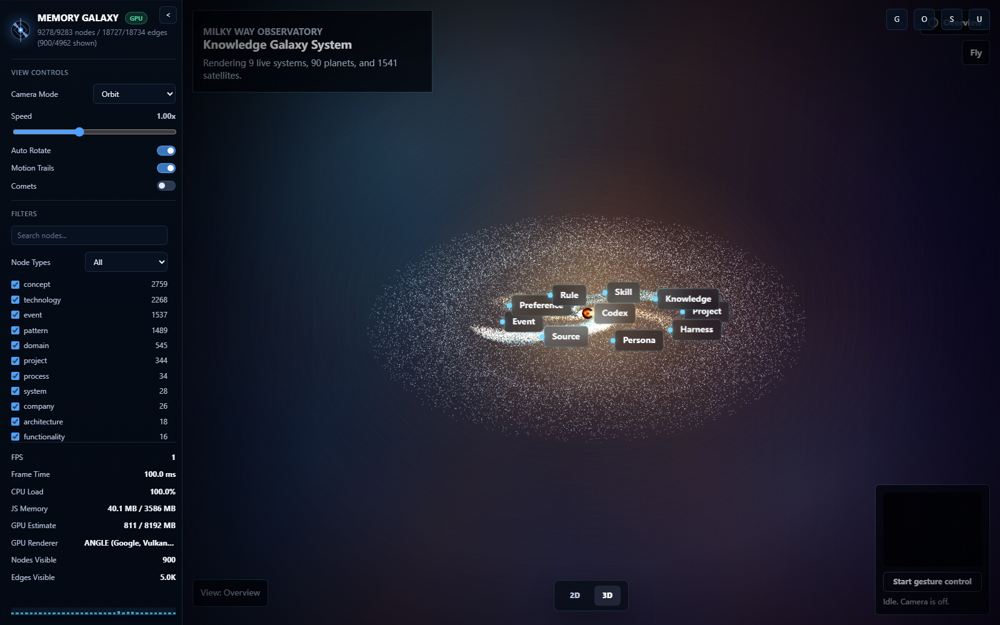
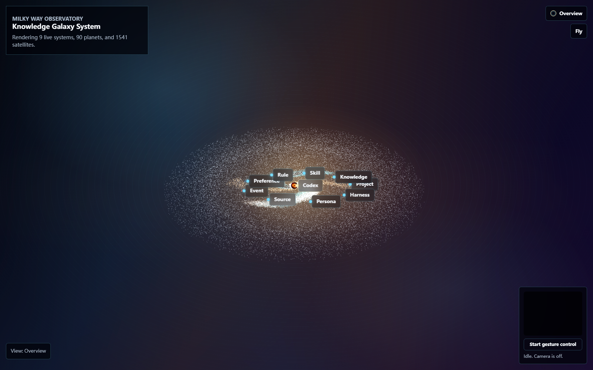
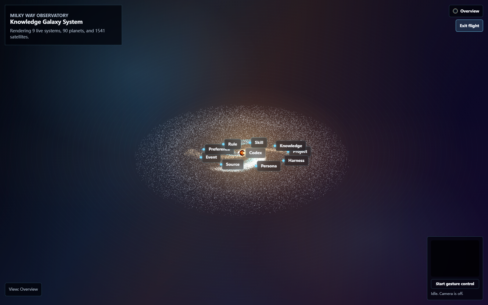

# v12.7.0 - Recall engine and Knowledge Galaxy 3D

Released 2026-07-27.

Memnex is a local-first memory layer for coding agents. It keeps durable
project memory on your machine, exposes it through MCP, and turns the same
knowledge graph into a browsable 2D/3D Memory Galaxy.

v12.7.0 focuses on two things: recall quality and the new Knowledge Galaxy 3D
surface. The recall path is now cleaner around embeddings, multi-representation
search, reranking, queue recovery, and diagnostics. The visual workspace gains a
full galaxy route that renders live graph-derived systems as an interactive
WebGL scene.

## Screenshots








## Why it matters

- **Local-first recall:** save, search, recall, reranking, graph expansion, and
  representation repair stay inside the local memory store.
- **Project-safe retrieval:** FTS, CJK FTS, semantic vectors,
  multi-representation search, episode expansion, and graph expansion keep the
  same project and namespace boundaries.
- **Better multilingual embeddings:** active text embeddings move to
  `jinaai/jina-embeddings-v2-base-zh` with a 768-dimensional vector space.
- **No LLM on the hot path:** fast mode can rerank with `fastembed-ce`, a local
  ONNX cross-encoder, while keeping synchronous save/search free of LLM calls.
- **Visual memory map:** the same graph can now be inspected as a Memory Galaxy
  workspace, a Knowledge Solar System, or the new Knowledge Galaxy route.

## What's new

### Recall stack

- Default FastEmbed text model changed from
  `sentence-transformers/paraphrase-multilingual-MiniLM-L12-v2` to
  `jinaai/jina-embeddings-v2-base-zh`.
- `memory_recall` now defaults `rerank` from the runtime mode; fast mode enables
  the local `fastembed-ce` backend.
- Multi-representation search fetches a deterministic, freshness-ordered
  candidate set instead of an arbitrary limited slice.
- The recall scorer receives the winning representation cosine as absolute
  semantic evidence, not just rank-only RRF signal.
- Relevance gates now handle semantic hits, graph expansion rows, and episode
  expansion rows with explicit diagnostics.

### Representation queue

- Stale `processing` rows are reclaimed.
- Obsolete `failed` rows can be pruned when a newer pending/done item exists.
- Inconsistent `done` rows are repaired when their raw representation is
  missing.
- Active records missing raw representation rows are re-enqueued.
- Queue snapshots expose health details for operators.

### Embedding migration

`scripts/migrate_embeddings_v127.py` performs an idempotent in-place migration:

```bash
python scripts/migrate_embeddings_v127.py --dry-run
python scripts/migrate_embeddings_v127.py
```

It re-encodes active `embeddings` from stored knowledge content and re-encodes
`knowledge_representations` from their existing representation text. It does
not regenerate summaries, call an LLM, or export private memory data.

### Knowledge Galaxy 3D

- New `knowledge-galaxy-system` route renders graph-derived galaxies, systems,
  planets, and satellites.
- The main Memory Galaxy workspace can switch between 2D, Knowledge Galaxy, and
  Knowledge Solar surfaces.
- Observatory and flight modes share reset and mode controls with the existing
  3D chrome.
- Launcher health checks cover the current Galaxy/Solar bundles, gesture worker
  assets, iframe routes, and live graph API.

## Quick start

Launch the local HTTP viewer:

```powershell
.\launch-memory-galaxy-viewer.cmd
```

Or export a static viewer from a memory database:

```bash
python src/tools/memory_graph_viewer_export.py --output ./graph-viewer-output
```

For large private graphs, use `--max-nodes`, `--max-edges`, or
`--min-edge-weight` only when the browser needs a smaller view.

## Validation

This release was checked against the active local memory database:

- active memories: `1147`
- active memories missing embeddings: `0`
- active memories missing FTS: `0`
- active memories missing CJK FTS: `0`
- representation queue: `done 1233`, no pending/failed/processing rows
- representation rows: `5140`
- active graph nodes: `9283`
- graph edges: `18734`
- active memories with active graph-node links: `1146 / 1147`

Local validation commands:

```bash
python -m pytest tests/test_representations_queue.py tests/test_run_drain.py tests/test_integration_representations.py tests/test_integration_multi_repr_search.py tests/test_integration_embed_wiring.py tests/test_reranker_backend.py -q
```

Result: `41 passed`.

The user explicitly requested that test code changes are not uploaded in this
release. The validation above describes the local checks used before packaging
the memory-library code.

## Privacy boundary

- Do not commit live `memory.db`, `memory.db-wal`, `memory.db-shm`, transcripts,
  raw captures, logs, tokens, cookies, or generated private `graph.json` exports.
- The screenshots in this release are real UI captures from the local viewer,
  but they contain only visualization UI and aggregate graph labels.
- The embedding migration updates local vector tables in place and does not
  upload memory content.
